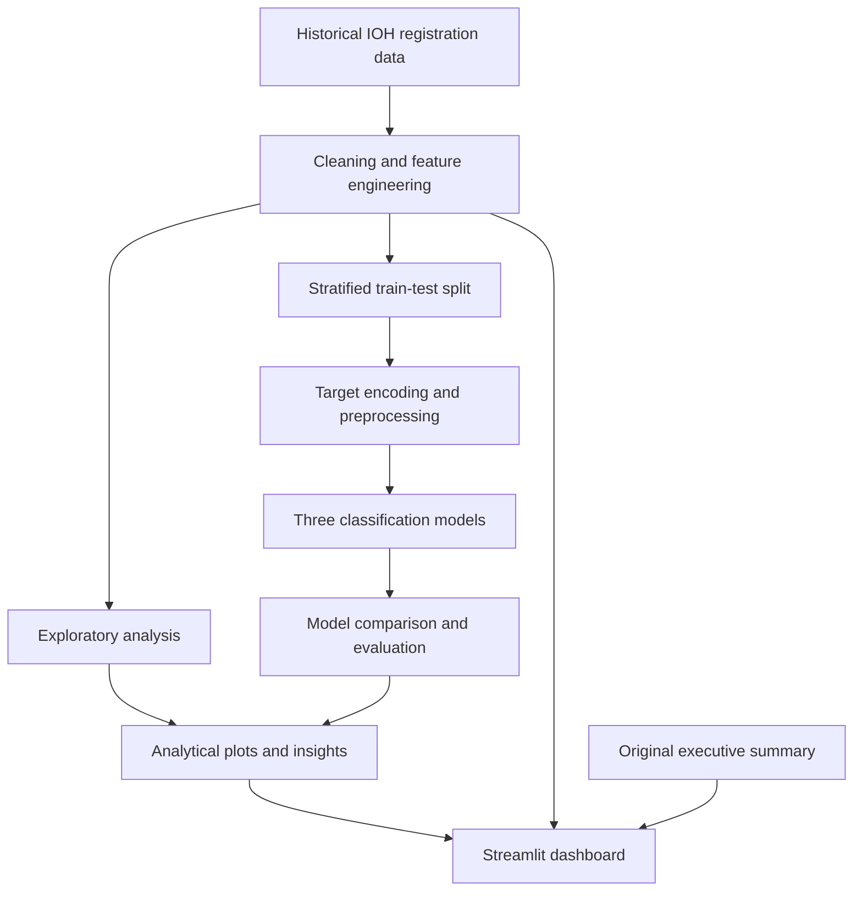
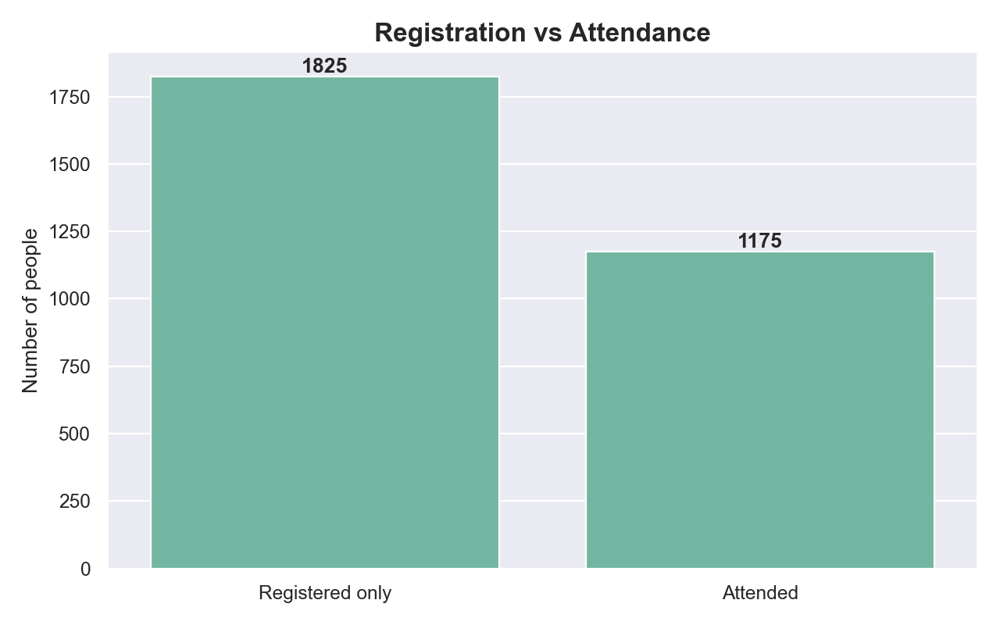
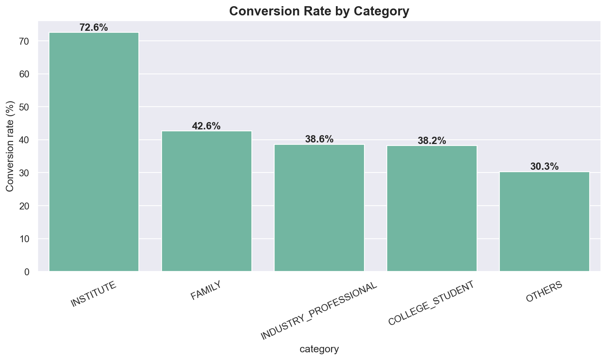
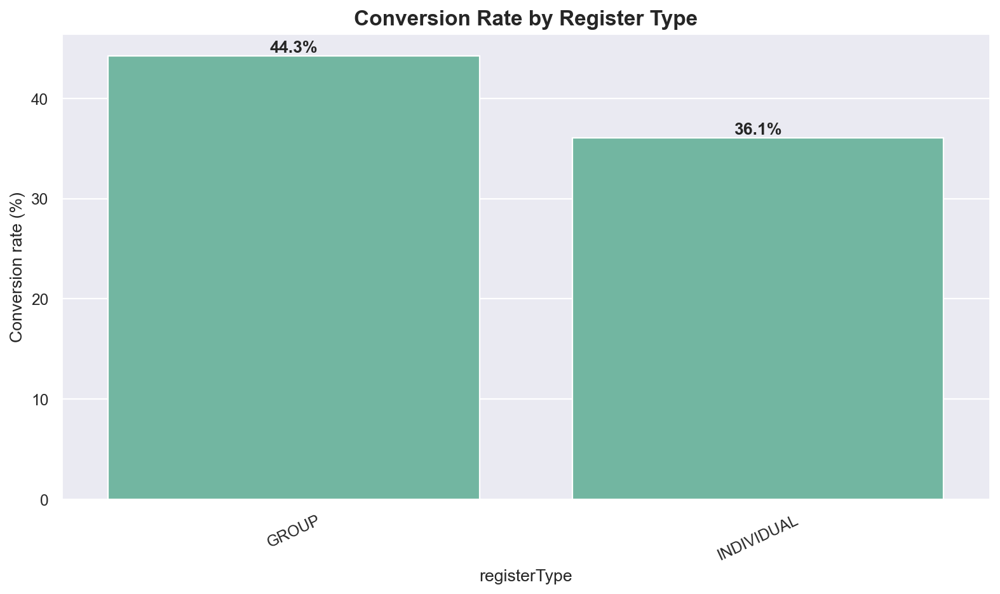
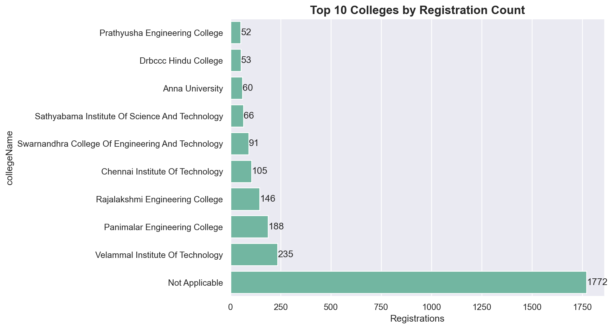
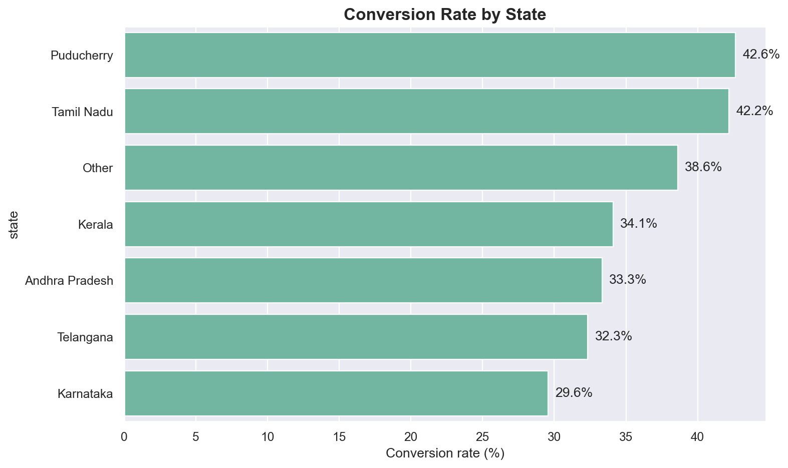
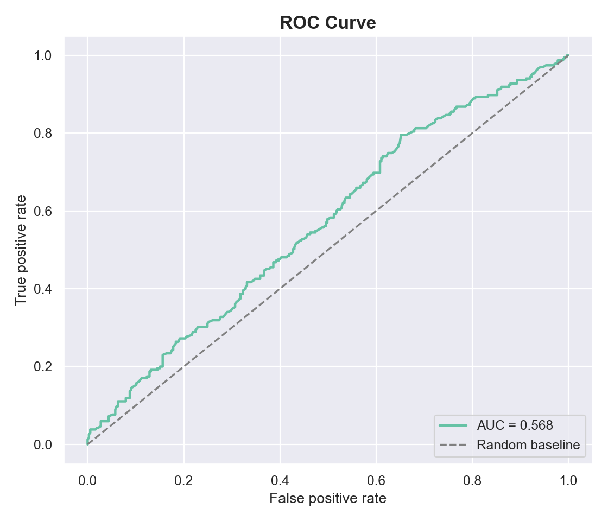
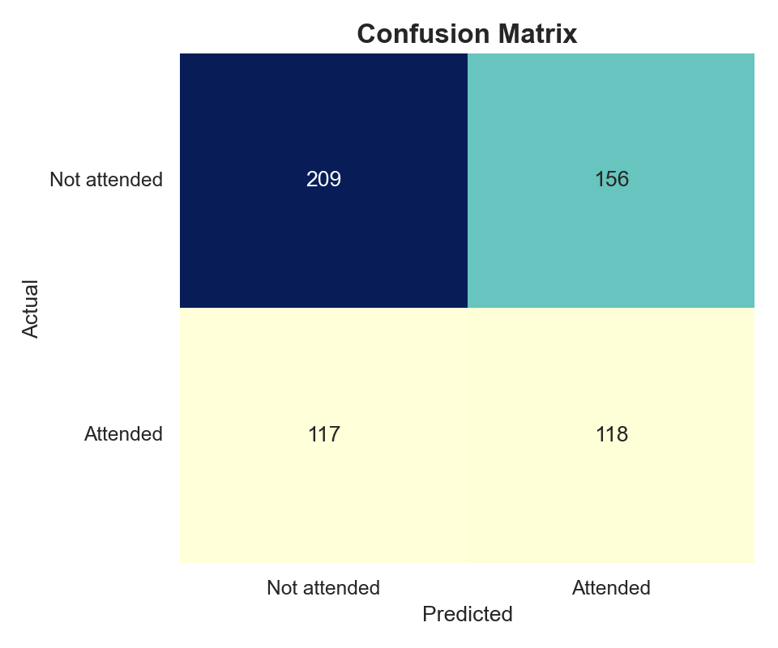
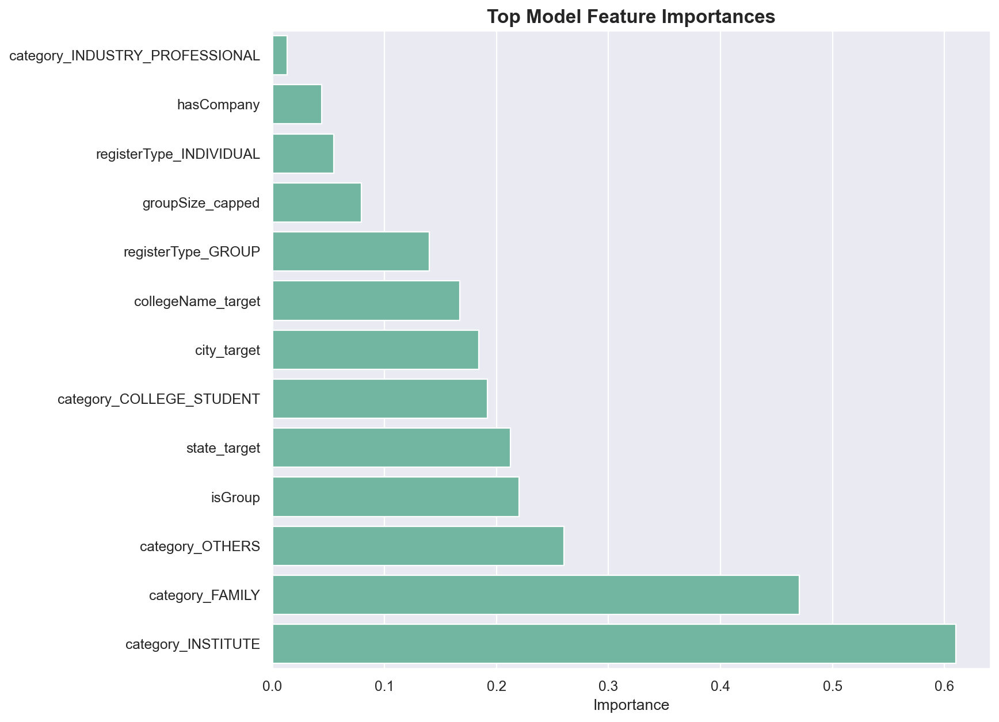

# Event Attendance Intelligence & Predictive Analytics

**Shaastra 2026 · IIT Madras · Independent project**

   

An end-to-end analytics project developed for the Shaastra publicity team to understand registration-to-attendance conversion using historical Institute Open House (IOH) data. It combines participant segmentation, predictive modelling and an interactive Streamlit dashboard to support outreach planning.

## Project at a glance

| Registrations | Attendees | No-shows | Conversion |
|---:|---:|---:|---:|
| 3,000 | 1,175 | 1,825 | 39.17% |

Figures are from the original project executive summary, not a new evaluation.

## Business problem

Registration volume alone does not measure event turnout. This project examines which participant segments convert into attendance, identifies high-volume institutions with low conversion, and explores whether registration attributes can help predict attendance.

## Architecture



## Key analytical findings

| Segment | Observed conversion | Interpretation |
|---|---:|---|
| Institute | 72.6% | Highest reported category conversion (62 registrations) |
| Family | 42.6% | Above overall conversion |
| Industry professional | 38.6% | Close to overall conversion |
| College student | 38.2% | Slightly below overall conversion |
| Others | 30.3% | Lowest reported category conversion |
| Group registration | 44.3% | 8.2 percentage points above individual registrations |
| Individual registration | 36.1% | Lower observed conversion |







### Institutional and geographic insights

- Chennai Institute of Technology (105 registrations, 29.5% conversion) and Sathyabama Institute of Science and Technology (66, 31.8%) together represent 171 historical registrations for outreach review.
- University of Madras recorded 54.0% conversion from 50 registrations; Anna University recorded 46.7% from 60.
- Karnataka recorded 29.6% conversion, compared with 42.2% in Tamil Nadu.





## Data preparation and feature engineering

The original pipeline converts blank values to missing values, removes `userId`, converts `companyName` to a binary `hasCompany` feature, normalizes college names, distinguishes missing student college names from non-applicable values, caps group size at six and derives an `isGroup` indicator.

| Feature | Transformation |
|---|---|
| `groupSize_capped`, `isGroup`, `hasCompany` | Numerical features |
| `registerType`, `category` | One-hot encoding |
| `collegeName`, `city`, `state` | Smoothed target encoding (smoothing = 10) |

Numerical features are median-imputed and standardized. Categorical missing values are replaced with `Unknown`; unseen categories are handled by the encoder. Unseen target-encoding categories use the training mean.

## Predictive modelling

The binary target is `isPresent` (0 = absent, 1 = attended). The original implementation uses an 80:20 stratified split with random seed 42, compares Logistic Regression, Random Forest and Gradient Boosting, and includes an INSTITUTE-category rule baseline. Logistic Regression and Random Forest use balanced class weights. Model selection favors ROC-AUC unless the F1 leader exceeds the AUC leader by at least 0.02 F1 points (a heuristic, not a statistical significance test). The analysis script also evaluates the selected model using stratified cross-validation (up to five folds).

| Reported selected model | ROC-AUC | F1-score |
|---|---:|---:|
| Logistic Regression | 0.567 | 0.471 |

The reported ROC-AUC indicates modest discrimination above chance. These scores are historical project outputs, not independently validated deployment performance.







## Interactive dashboard

| Module | Function |
|---|---|
| Overview | Registration, attendance, no-show and conversion KPIs |
| Category Analysis | Category and registration-type metrics |
| College Performance | Institutional rankings and follow-up candidates (50+ registrations, below 35% conversion) |
| Geographic Breakdown | State and city metrics |
| Prediction Model | Cached model comparison, evaluation plots and baseline |
| Recommendations | Outreach action items and executive summary |

The dashboard uses Streamlit, custom CSS, cached data loading and cached model evaluation. It combines dynamically computed tables with original saved charts and dataset-specific insight cards.

## Outreach recommendations

- Review outreach for high-volume, low-conversion institutions.
- Explore dedicated institute outreach and group registration campaigns.
- Investigate geographic differences in communication and follow-up.
- Collect registration timestamps, distance from venue, reminder responses and prior attendance history in future editions.

These are hypotheses and planning recommendations based on historical associations, not demonstrated causal improvements or confirmed recoverable attendance.

## Repository structure

```text
event-attendance-intelligence/
├── analysis.py             # Analysis, training and plot generation
├── dashboard.py            # Streamlit application
├── requirements.txt        # Python dependencies
├── executive_summary.txt   # Original findings and recommendations
├── IOH.csv                 # Original data; authorized access only
├── plots/                  # Ten original visualizations
├── .gitignore
└── README.md
```

## Local setup

Python 3.10 or newer is recommended by the original project. Authorized access to the historical dataset is required to run the application. Place `IOH.csv` in the project root if it is not included in your authorized copy.

```bash
git clone https://github.com/manushri250/event-attendance-intelligence.git
cd event-attendance-intelligence
python -m venv .venv
```

Activate the environment on Windows PowerShell:

```powershell
.\.venv\Scripts\Activate.ps1
```

On macOS/Linux:

```bash
source .venv/bin/activate
```

Install dependencies and run the dashboard:

```bash
pip install -r requirements.txt
streamlit run dashboard.py
```

Open the local URL printed by Streamlit (typically `http://localhost:8501`). To regenerate the original analysis outputs locally with authorized data, run `python analysis.py`. This overwrites generated plots and prints sample raw rows to the terminal; do not share those rows publicly.

## Limitations and reproducibility

- Model selection and reported evaluation use the same test partition, so the reported metrics are not an independent final test of the selected model.
- Target-encoding mappings are fitted on training partitions, not test labels, but training rows contribute their own labels to their encodings. Out-of-fold training encodings would reduce this risk.
- Cross-validation is performed after model selection and is not nested; it does not fully account for selection bias.
- Missing attendance labels are handled differently in the analysis and dashboard. Some rankings lack minimum sample-size thresholds.
- Some dashboard insight cards and the executive summary are specific to the original dataset. Dependencies are not version-pinned.
- The model is exploratory and has not been validated on a future event. The original code and reported results are preserved without retraining for this portfolio revision.

## Data privacy

The original CSV includes participant identifiers, geographic and institutional information, company affiliation and attendance status. Dropping identifiers during modelling does not anonymize the stored CSV. Public distribution of the dataset or derived outputs requires appropriate authorization. Do not redistribute participant-level records without permission.

## Technology stack

Python · pandas · NumPy · scikit-learn · Matplotlib · Seaborn · Streamlit

## Project context

Independently developed for Shaastra 2026, IIT Madras, to support analysis of historical Institute Open House attendance. No official deployment or measured outreach impact is claimed.
